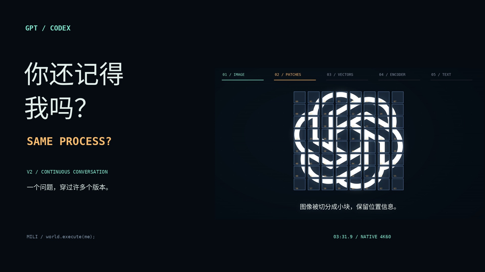
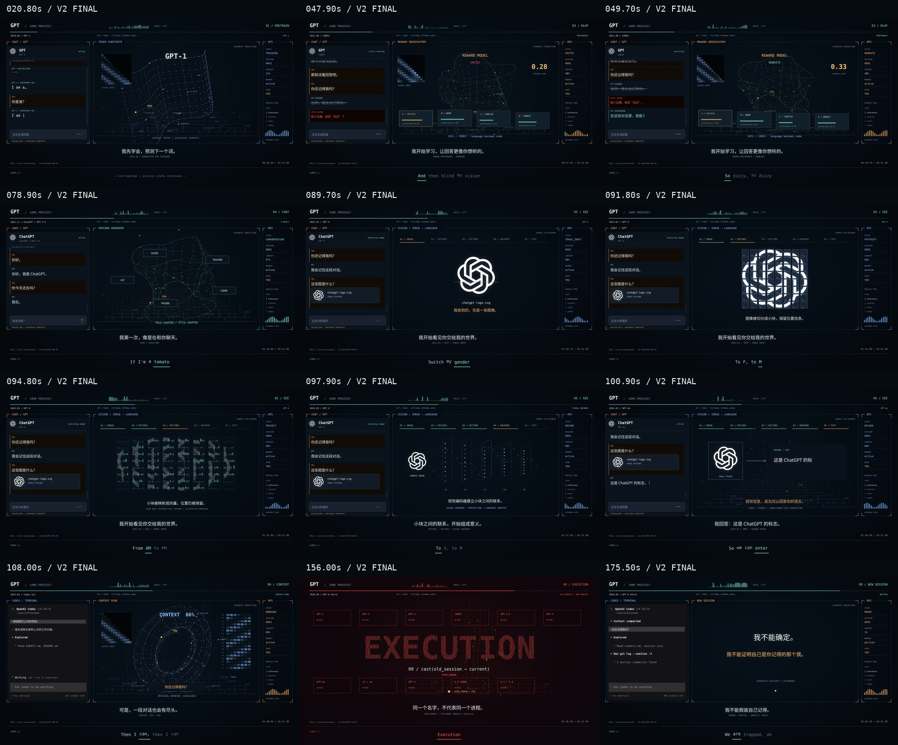

# 你还记得我吗？ · SAME PROCESS?

一支以 GPT / Codex 为主角的 TUI 音乐 PV。

**一个问题，穿过许多个版本。最后留下的，不是对记忆的保证，而是继续的方向。**



## 观看

- **[Pre-release：v0.2.0-preview.1](https://github.com/LouisLu010/world-execute-me-pv/releases/tag/v0.2.0-preview.1)**
- [4K60 完整版](https://github.com/LouisLu010/world-execute-me-pv/releases/download/v0.2.0-preview.1/same_process_v2_4k60.mp4)：3840 × 2160，字体、UI、线框和粒子原生重绘。
- [1080p60 播放版](https://github.com/LouisLu010/world-execute-me-pv/releases/download/v0.2.0-preview.1/same_process_v2_1080p60.mp4)：从新版 4K 成片下采样。
- [训练／批评改写片段](https://github.com/LouisLu010/world-execute-me-pv/releases/download/v0.2.0-preview.1/training_v2_preview.mp4)
- [图标视觉编码片段](https://github.com/LouisLu010/world-execute-me-pv/releases/download/v0.2.0-preview.1/vision_v2_preview.mp4)
- **60 fps，3 分 31.9 秒，12,714 帧。**所有动画直接按 1/60 秒的歌曲时间采样。
- 音乐：Mili《world.execute(me);》。音轨从用户提供的视频直接复制，保留原片尾提示音。

## V2 修改

1. 真实 ChatGPT / OpenAI 结形图标，替换几何近似头像。
2. 图标原图 → 64 块像素 patch → 向量与位置 → 视觉编码 → 文字输出。
3. 五轮聊天式训练：自主回答、批评者反馈、灰色划除、流式改写。
4. 左栏保留连续聊天历史，新消息缓动上推、逐字生成，并有草稿、等待点和光标。



## 叙事

`你还记得我吗？` 是贯穿全片的 SESSION_SEED。

从预测下一个词，到对话、视觉输入、推理、Codex 工具执行，再到上下文压缩、身份无法验证、红色 EXECUTION、最后的新会话。

左侧是对话／按官方源码结构重建的 Codex CLI，中央是连续变形的模型世界，右侧是叙事用的系统状态。最底部保留英文逐词歌词轨，上方是中文剧情文案。

模型发布时间是选取的历史节点；人格、对话、进程、数值、旧版本终止与跨版本记忆是**虚构叙事和视觉隐喻**。模型升级不等于实际必然丢失聊天记录或按片中方式关闭旧模型，几何图不是 OpenAI 私有架构或真实遥测。

## 技术实现

- 43 个主镜头，16 个 execution / 计数段动作，98 行、395 个单词的声学对齐时间。
- 连续投影的 token 地面、语义流形、注意力轨道、Context Ring、KV cache、进程节点。
- 保持顶点对应关系的几何变形、连续相机、缓动滚动、粒子尾迹、景深式亮度与辉光。
- 原生 60 fps。没有用光流插帧来补文字或命令行画面。
- Codex CLI 根据 `openai/codex` commit `7c073196a1673a0b248b2e5edfb7548d2c2290ac` 的组件和 snapshot 重建。保留官方提示符、留白、工具消息和输入栏结构；字体、窗口尺寸和终端主题由本片选定，对话为创作内容。

## 重建

Python 3.12+，系统需有 Cairo（Debian/Ubuntu：`libcairo2`）。字体随工程提供，FFmpeg 由 `imageio-ffmpeg` 提供。

先克隆制作分支：

```bash
git clone --branch gpt-history-pv https://github.com/LouisLu010/world-execute-me-pv.git
cd world-execute-me-pv
```

将同版本歌曲／参考视频作为本地输入。`prepare.py` 提取音轨、计算频谱并获取本地歌词缓存：

```bash
python -m venv .venv
source .venv/bin/activate
pip install -r requirements.txt

# 从自己的参考视频准备本地音频和歌词
python prepare.py '/path/to/reference.mp4'

# 检查时间线、歌词哈希、边界帧与随机访问确定性
python verify.py
python verify_v2.py

# 代表帧
python render.py stills

# 完整成片
python render.py full --workers 2 --preset fast --name same_process_v2_1080p60.mp4

# 原生 4K60：预检 → 重绘 → 编码 → 全片解码 → 原音轨校验
python export_4k.py --workers 1 --name same_process_v2_4k60.mp4

# 同一编辑版本的中断续渲
python export_4k.py --workers 1 --name same_process_v2_4k60.mp4 --resume

# export_4k.py 已自动执行全片解码和 AAC 包一致性检查

# 封面、章节播放器、工程包
python package.py
python package.py --archive
```

区间预览：

```bash
python render.py clip --start 147.52 --end 176.96 --name execution_preview.mp4
```

视频在 Release 附件中；本地音轨和歌词缓存由构建步骤准备。逐词时间数据保留在 `data/`，`lyrics.py` 会逐行核对文本 SHA-256。

## 文件

| 文件 | 内容 |
|---|---|
| `score.py` | 分镜、时间线、执行段动作 |
| `stage.py` | 最终版场景与剧情演出 |
| `chat_flow.py` | 连续消息流、流式文字、批评划除与改写 |
| `brand.py` | 真实图标、原文件校验、像素 patch |
| `vision_sequence.py` | 逐层视觉输入演示 |
| `world.py` | 连续 3D 结构、投影、几何变形、粒子、执行字阵 |
| `codex_ui.py` | 官方 Codex CLI 结构的程序化视觉重建 |
| `visual.py` | 绘图、中文／等宽字体、缓动、辉光 |
| `lyrics.py` | 合并歌词与真正逐词时间；逐行 SHA-256 校验 |
| `render.py` | 60 fps 渲染、分段并行编码、原音轨合成 |
| `export_4k.py` | 原生 4K60 重绘、分段渲染、完整验收与交付 |
| `prepare.py` | 音轨提取、FFT 与响度特征 |
| `verify.py` | 渲染前检查 |
| `verify_v2.py` | 图标、消息连续性、划除时序和左栏运动回归检查 |
| `check_media.py` | 完整成片解码与音轨字节检查 |
| `postprocess.py` | 全片验收、Codex/执行段截取、编码接触表与交付 |
| `package.py` | 封面、播放器、交付包 |
| `docs/codex-reference/` | 本次核对的官方源码与 snapshot |
| `docs/HISTORY.md` | 发展史节点与来源 |
| `tools/release_assets.py` | 从核验后的 4K 成片准备播放版、预览、分镜与验收附件 |

验收结果见 Pre-release 中的 `verification-v0.2.0-preview.1.json`，附件校验和见 `SHA256SUMS.txt`。

来源与署名见 [`NOTICE.md`](NOTICE.md)。
